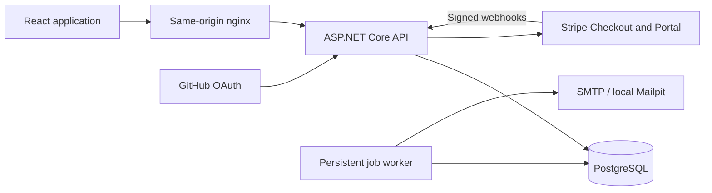

# Architecture

Tenlith is a modular monolith. The API owns identity, organizations, projects,
billing and durable background work. The React application consumes a same-origin
HTTP API. PostgreSQL stores application data and jobs. SMTP delivers account and
team emails; Mailpit catches those messages in local development.

## Boundaries

Features own their endpoint behavior rather than routing every request through
generic repositories. EF Core is the persistence boundary. Shared infrastructure
contains identity/session handling, tenant checks, persistence and job processing.
The small Projects feature demonstrates how to add your own domain.

An account is global; membership and role belong to an organization. Resource
lookups include the organization ID and a verified membership. A supplied ID or
tenant header grants no authority. Owner, Admin and Member permissions are checked
on the API even when the UI hides an action.

Project writes and membership/invitation capacity checks must serialize on their
organization so competing requests cannot bypass the limits. Background work
must explicitly carry its organization's identity; it must not use an HTTP ambient
tenant inherited from an unrelated request.

## Sessions

The browser holds an access token in memory. An HttpOnly refresh cookie lets it
restore the session. Rotation stores token hashes; reuse revokes the token family.
Mutation requests include a custom header and are origin-checked. OAuth callbacks
use the framework's state/correlation protections. Identity's verification and
recovery tokens are URL-encoded in email links.

Access tokens remain valid until their short expiry after ordinary logout; refresh
credentials are revoked. Do not describe JWT logout as instant revocation of all
issued bearer tokens.

## Billing

The server enforces entitlements. Stripe webhooks are verified before processing,
deduplicated and reconciled against provider state rather than trusting delivery
order or checkout redirects. A local simulation path exists only in Development.
See [billing](billing.md) for configuration and external validation.

## Tradeoffs

- A shared database is simpler to operate; tenant isolation is an application
  responsibility backed by integration tests, not a separate database per customer.
- The worker runs in the API process for a small deployment. Multiple instances
  require safe job claiming and a shared Data Protection key ring.
- Local demo accounts create real records. Do not expose unlimited demo creation
  publicly without abuse controls and a data-retention policy.
- No Redis or message broker is required. Introduce either only for a concrete
  workload and document its failure behavior.

The [API contract](api-contract.md) describes the frontend/backend boundary.
